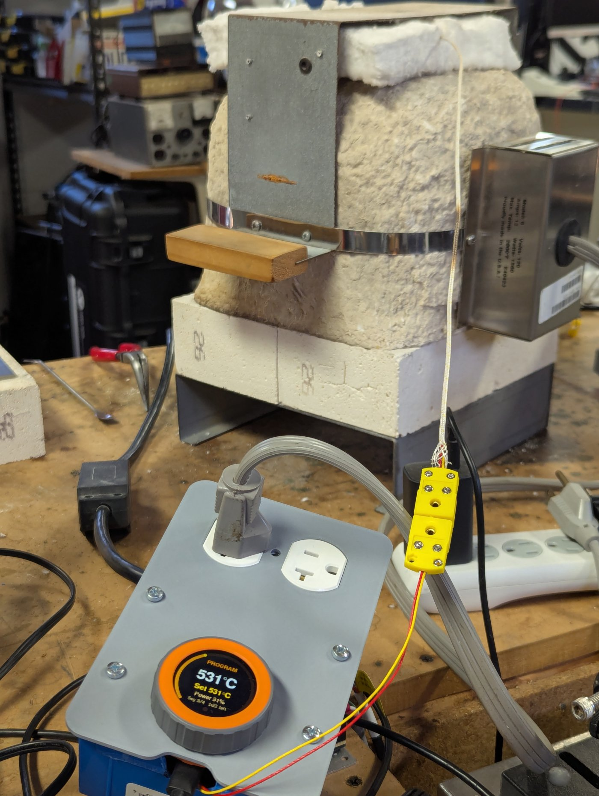
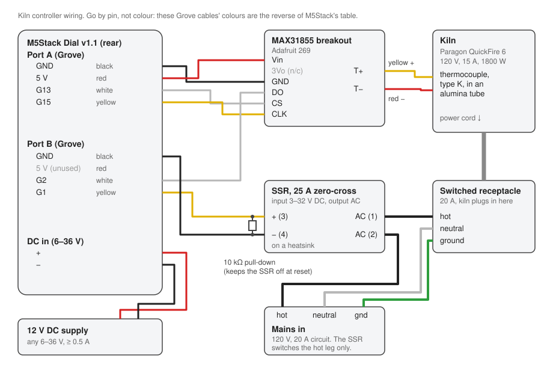

# Kiln Controller (M5Stack Dial)

A small-kiln controller built around the M5Stack Dial: a PID loop driving a solid-state relay, ramp/hold firing programs that run on the controller by themselves (and survive a disconnect or power loss), on-device step tests for PID tuning, and a zero-install browser app that talks to it over USB.



## Construction

### Parts

| Part | Notes | Where |
|---|---|---|
| **M5Stack Dial v1.1** (K130-V11) | ESP32-S3 with a round LCD, rotary knob, buzzer and two Grove ports | [M5Stack store](https://shop.m5stack.com/products/m5stack-dial-v1-1), [docs](https://docs.m5stack.com/en/core/Dial_v1.1) |
| **MAX31855 thermocouple amplifier** (type K) | Use a breakout with its own 3.3 V regulator: it's powered from the Grove 5 V | [Adafruit 269](https://www.adafruit.com/product/269) |
| **Type-K thermocouple** | Rated for kiln temperatures. Run it into the kiln through an alumina tube; mini type-K connectors make it removable | e.g. [Paragon's QuickFire 6 thermocouple](https://paragonkilns.com/products/thermocouple-type-k-for-quickfire-6-kilns-4506) |
| **Solid-state relay**, zero-cross, 25 A, 3–32 V DC input, AC output | Mount it on a heatsink. Generic "SSR-25DA" relays work; cheap ones are often counterfeit and under-rated, so size it at well over the kiln's current | [search](https://www.google.com/search?q=SSR-25DA+zero+cross+solid+state+relay+heatsink) |
| **12 V DC power supply** | Feeds the Dial's rear 6–36 V terminal (about 80 mA at 12 V) | any 12 V adapter or DIN-rail supply |
| **Grove-to-jumper cables** (×2) | For the Dial's Port A and Port B | [M5Stack Grove2Dupont](https://shop.m5stack.com/products/grove2dupont-conversion-cable-20cm-5pairs) |
| **10 kΩ resistor** | Pull-down on the SSR input so it stays off while the Dial resets | |
| **Enclosure, 20 A receptacle, 12 AWG wire, cord and plug** | Mains side: the SSR switches the receptacle the kiln plugs into | hardware store |
| **Kiln** | Built and tuned on a Paragon QuickFire 6 (120 V, 15 A, 1800 W), but any single-SSR kiln works | [Paragon](https://paragonkilns.com/products/quikfire-test-kiln) |

### Wiring



| Signal | Dial pin | Connector | Wire colour (measured) |
|---|---|---|---|
| SSR input + (10 kΩ pull-down to GND at the SSR) | G1 | Port B | yellow |
| MAX31855 DO (SO) | G2 | Port B | white |
| MAX31855 CS | G13 | Port A | white |
| MAX31855 CLK (SCK) | G15 | Port A | yellow |
| MAX31855 Vin, GND | 5 V, GND | Port A | red, black |
| SSR input − | GND | Port B | black |
| 12 V supply | DC in +, − | rear terminal | |

- **Go by the pin, not the colour.** On these Grove cables the yellow and white wires are the reverse of M5Stack's documented colour table. Check with a meter if in doubt.
- The SSR is on Port B because that port has no I²C pull-ups, so the line can't float high and switch the kiln on during boot or reset. The 10 kΩ pull-down makes sure of it.
- The thermocouple goes to the MAX31855's T+ (yellow, on US type K) and T− (red).
- **Mains:** the SSR's AC terminals go in series with the **hot** leg to the receptacle. Neutral and ground go straight through. Use wire and a circuit rated for the kiln (a 15 A kiln wants a 20 A circuit and 12 AWG).

### Assembly notes

- Mount the MAX31855 board away from the kiln's heat: its own temperature is the thermocouple's cold-junction reference.
- At high temperature, current leaks from the elements through the hot refractory into the thermocouple, and the MAX31855 flags "short to GND/VCC" while the SSR is on. The firmware expects this and keeps using those readings (see [web/README.md](web/README.md#what-stops-heating)). A grounded metal sheath on the thermocouple, or an isolated amplifier, removes it at the source.
- Firmware safety: the SSR pin is low through reset and flashing, a 5 s watchdog resets a hung loop, a reading of 1425 °C or more stops heating, and heating stops if there's no usable thermocouple reading for 30 s. There is no mechanical contactor in this build. SSRs usually fail shorted, so don't leave a firing unattended without one (see [PROPOSAL.md](PROPOSAL.md) §2.3).

## Using it

**On the Dial:**

| Input | Action |
|---|---|
| Turn | Choose a setpoint from 0 to 1400 °C: 5 °C per click, 25 or 100 °C when spun fast. It applies after 1.2 s without turning, or on a click. |
| Click | Start or stop heating at the setpoint |
| Hold 1.5 s | Stop heating, or a running program or step test |

The screen shows the state, the actual temperature, the setpoint, the power level and a red dot while the SSR is on. The ring is a 0–1400 °C gauge. If something stops heating (a fault, or a failed step test), the reason stays on screen in red until you click.

**In the browser:** `web/` is a zero-install app for Chrome or Edge that connects over USB with Web Serial. Double-click [`web/kiln-controller.html`](web/kiln-controller.html), click **Connect** and pick the controller. It shows live temperature, setpoint and power with a history chart and CSV export, and it:

- edits firing programs in a table or by dragging points on a chart, sends them to the controller and starts them. A running program can be edited or moved in time without stopping it.
- runs step tests at chosen temperatures and builds the PID tuning table (gains plus holding power, interpolated by setpoint), and edits the baseline gains.
- shows why heating last stopped, and any thermocouple warnings.

Open it with `?demo` to try it against a simulated kiln with no hardware. See [web/README.md](web/README.md) for details, tuning, and the serial protocol.

Programs run on the controller, not the PC: closing the page or unplugging USB changes nothing. Progress is checkpointed every minute, and after a power cut the program resumes if the kiln is still within 50 °C of where it was.

## Build and flash

The firmware is a [PlatformIO](https://platformio.org/) project. With PlatformIO installed as a Python package:

```bash
python -m platformio run -e m5dial -t upload
```

`upload` finds the port by itself. The firmware uses TinyUSB CDC, so esptool's usual DTR/RTS reset doesn't reach it; instead the upload opens the port at 1200 baud, which reboots the board into the ROM bootloader, and `scripts/clear_download_flag.py` then lets the new firmware start. The firmware accepts that reboot **only while not heating**, so a computer can't reboot it mid-firing. For a first flash, or if the firmware has crashed, hold the Stamp's G0 button while plugging in USB-C.

`m5dial-sim` is a build with a simulated kiln in place of the thermocouple. It never drives the SSR, so the UI and web app can be developed with nothing connected:

```bash
python -m platformio run -e m5dial-sim -t upload
```

After changing anything in `web/`, regenerate the single-file app:

```bash
python scripts/build_web.py
```

## Tests

`lib/kiln_core` holds the hardware-independent parts: MAX31855 decoding and NIST type-K linearization, PID, SSR time-proportioning, firing programs, the step test and tuning table, and a kiln model to test them against. To run its tests on the Dial:

```bash
python -m platformio test -e m5dial
```

To run them on a PC, `pio test -e native` needs g++ on PATH. Without it, use the `ziglang` compiler from pip (`pip install --user ziglang`). Run `python -m platformio test -e native` once first, so it downloads Unity into `.pio/libdeps/native`:

```bash
python -m ziglang cc -c .pio/libdeps/native/Unity/src/unity.c -o unity.o && python -m ziglang c++ -std=c++17 -I lib/kiln_core/src -I .pio/libdeps/native/Unity/src test/test_core/test_core.cpp lib/kiln_core/src/*.cpp unity.o -o test_core.exe && ./test_core.exe
```

## Files

| Path | Contents |
|---|---|
| `src/` | Firmware: main loop, display, encoder, MAX31855 driver, non-blocking USB output |
| `lib/kiln_core/` | Hardware-independent control code (unit tested) |
| `test/` | Unit tests |
| `web/` | Browser app; `kiln-controller.html` is the generated single-file build |
| `scripts/` | Web bundler and the post-upload bootloader fix |
| `PROPOSAL.md` | The original design, with the reasoning behind the pin choices and safety features |

## License

[MIT](LICENSE)
